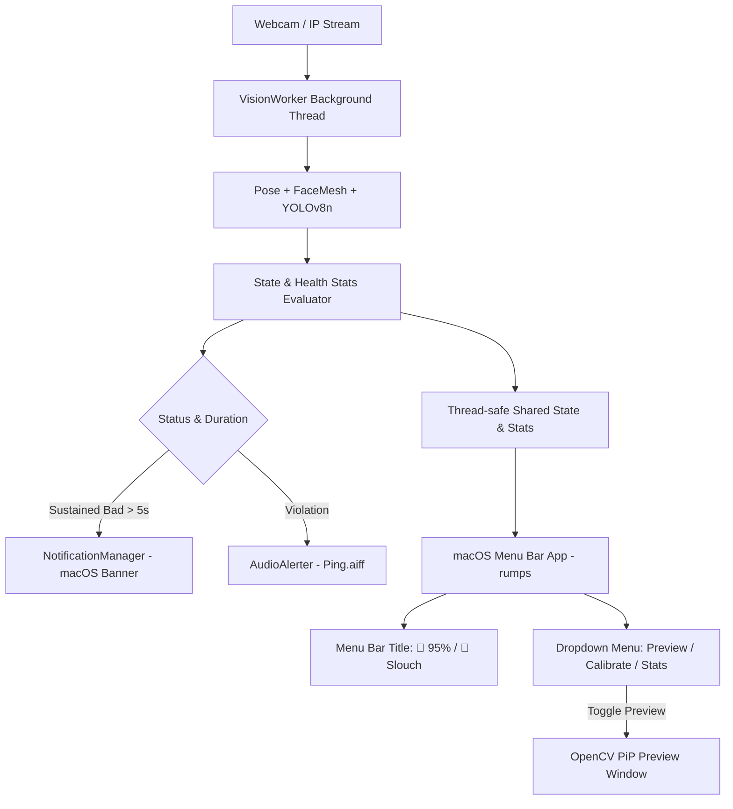

# Technical Design Spec: macOS Menu Bar & Background Mode

## 1. Overview & Objective
Upgrade the **Workplace Health & Focus Monitor** from a standalone foreground OpenCV window to a sleek, native **macOS Menu Bar Application** that runs silently in the background while the user codes or works:
- Stays quietly in the macOS status bar (top-right menu bar) with real-time status emojis (`🟢`, `🔴`, `🟠`, `🟣`).
- Runs vision inference in an efficient background worker thread with CPU throttling.
- Dispatches macOS Native Notification banners when violations persist for more than 5 seconds.
- Allows toggling an on-demand, lightweight Camera Preview window.
- Provides interactive menu actions: Calibrate, Mute audio, Toggle notifications, View session health stats, and Quit.
- Preserves full backward compatibility with the `--cli` foreground interactive mode.

---

## 2. Architecture & Components

```
Workplace Health & Focus Monitor/
├── src/
│   ├── config.py                 # Configuration + settings for background mode & notifications
│   ├── posture_detector.py       # Angle calculation & calibration
│   ├── drowsiness_detector.py    # EAR & MAR fatigue detection
│   ├── phone_detector.py         # YOLOv8n phone detection
│   ├── audio_alerter.py          # Non-blocking audio alerts
│   ├── notification_manager.py   # macOS Native Notification manager with sustained duration filter
│   ├── hud_renderer.py           # HUD overlay renderer for camera preview window
│   ├── vision_worker.py          # Background processing thread managing CV loop & shared state
│   ├── menu_bar_app.py           # macOS native status bar application using rumps
│   └── main.py                   # Unified CLI entrypoint supporting both --menubar and --cli modes
├── tests/
│   ├── test_notification_manager.py # Unit tests for notification debouncing & sustained threshold
│   └── test_vision_worker.py        # Unit tests for thread safety, state updates, and stats
├── requirements.txt
└── README.md
```

### Component Breakdown

1. **`notification_manager.py`**:
   - `NotificationManager`:
     - Checks if a violation (slouch, drowsiness, phone) has been sustained for $\ge 5.0s$.
     - Dispatches macOS notification banner via `osascript`:
       `display notification "..." with title "Workplace Focus Monitor" subtitle "Cảnh báo tư thế"`
     - Enforces a minimum interval between notifications ($30.0s$) to avoid interruption fatigue.

2. **`vision_worker.py`**:
   - `VisionWorker(threading.Thread)`:
     - Owns the `VideoCapture` and detectors (`PostureDetector`, `DrowsinessDetector`, `PhoneDetector`).
     - State variables protected by locks: `current_status`, `posture_result`, `is_calibrated`, `is_preview_visible`, `stats`.
     - Statistics accumulator:
       - `total_active_seconds: float`
       - `good_posture_seconds: float`
       - `posture_score: float` ($= \frac{good\_seconds}{total\_seconds} \times 100\%$)
       - `violation_counts: Dict[str, int]` (slouch, drowsy, phone)
     - Dynamic FPS Throttling:
       - When preview is hidden (normal background work): sleeps ~0.08s per frame (~12 FPS) to keep CPU utilization minimal ($< 3\%$).
       - When preview is open: runs at full camera frame rate (~30 FPS).
     - Methods: `calibrate()`, `toggle_preview()`, `reset_stats()`, `stop()`.

3. **`menu_bar_app.py`**:
   - Subclasses `rumps.App("Workplace Health", title="🧘 100%")`.
   - Periodic timer (every 1.0s):
     - Queries `VisionWorker.get_state()`.
     - Updates status bar icon/title:
       - 🟢 `🧘 94%` (Good posture)
       - 🔴 `⚠️ Slouch` (Bad posture)
       - 🟠 `😴 Drowsy` (Eyes closed / yawn)
       - 🟣 `📱 Phone` (Phone distraction)
     - Updates menu item subtitles.
   - Menu Items:
     - `📊 Thống kê: 95% Tư thế chuẩn` [Info]
     - `📸 Bật/Tắt Cửa sổ Camera` -> toggles OpenCV preview window
     - `🎯 Căn chỉnh tư thế (Calibrate)` -> triggers calibration
     - `🔔 Thông báo hệ thống: Bật/Tắt`
     - `🔊 Âm thanh cảnh báo: Bật/Tắt`
     - `📈 Báo cáo chi tiết hôm nay...` -> native popup dialog summarizing performance
     - `🚪 Thoát`

4. **`main.py`**:
   - If `--cli` argument is passed: runs the original OpenCV fullscreen/interactive demo mode.
   - Default: launches the macOS Menu Bar application.

---

## 3. Data Flow



