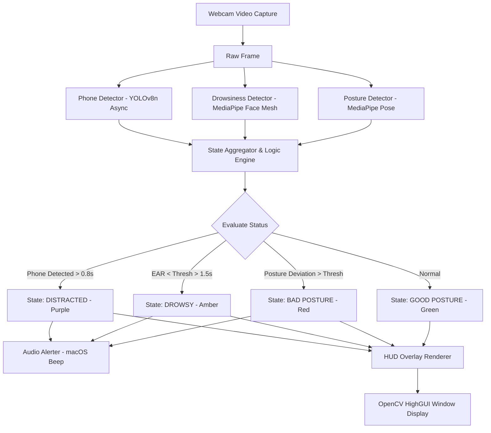

# Technical Design Spec: Workplace Health & Focus Monitor

## 1. Overview & Objective
An interactive, real-time computer vision system running on Apple Silicon (Mac Mini M4) via macOS webcam to:
- Monitor sitting posture (slouching, deep forward neck tilt, leaning back, shoulder asymmetry).
- Detect drowsiness & fatigue (prolonged eye closure, yawning).
- Detect distractions (smartphone usage).
- Provide immediate visual HUD feedback (Green: Good Posture, Red: Bad Posture, Orange: Distracted/Drowsy) and macOS native non-blocking audio alerts.
- Offer live interactive demo controls (Calibration key `C`, Mute key `M`, Reset stats key `R`, Quit `Q`).

---

## 2. Architecture & Components

```
workplace-focus-monitor/
├── src/
│   ├── config.py                 # Configuration thresholds, parameters, colors, sounds
│   ├── posture_detector.py       # Landmark extraction & angle calculation (MediaPipe Pose)
│   ├── drowsiness_detector.py    # Eye Aspect Ratio (EAR) & Mouth Aspect Ratio (MAR) (MediaPipe Face Mesh)
│   ├── phone_detector.py         # Asynchronous / frame-skip object detector (YOLOv8n)
│   ├── audio_alerter.py          # Non-blocking async audio alert via macOS afplay/system sound
│   ├── hud_renderer.py           # Real-time HUD visual overlay engine
│   └── main.py                   # Central coordination loop & video capture
├── tests/
│   ├── test_posture.py           # Unit tests for posture math & baseline logic
│   └── test_drowsiness.py        # Unit tests for EAR and MAR geometric calculations
├── requirements.txt              # Dependencies: opencv-python, mediapipe, ultralytics, numpy
└── README.md                     # Setup guide, run command, keyboard shortcuts
```

### Component Details
1. **`config.py`**:
   - Camera input index (default `0`).
   - Posture angle thresholds: $\Delta_{neck} = 15^\circ$, $\Delta_{torso} = 12^\circ$.
   - Drowsiness thresholds: $EAR_{threshold} = 0.21$, consecutive closure time $1.5s$; $MAR_{threshold} = 0.65$, duration $2.0s$.
   - Phone detection: confidence $0.50$, trigger debounce $0.8s$.
   - Alert debouncing: minimum interval between beeps ($2.0s$).

2. **`posture_detector.py`**:
   - Uses `mediapipe.solutions.pose`.
   - Computes neck angle: arctan2 of lateral distance vs vertical distance between ear and shoulder landmarks.
   - Computes torso angle: arctan2 of lateral distance vs vertical distance between shoulder and hip landmarks.
   - Calibration state: stores $\theta_{neck}^{base}$ and $\theta_{torso}^{base}$. When deviation exceeds threshold, flags bad posture.

3. **`drowsiness_detector.py`**:
   - Uses `mediapipe.solutions.face_mesh` with `refine_landmarks=True`.
   - Extracts 6 eye landmarks per eye to calculate Eye Aspect Ratio (EAR).
   - Extracts outer/inner lip landmarks to calculate Mouth Aspect Ratio (MAR).
   - Tracks timestamp duration of low EAR / high MAR to avoid false alarms from normal blinking.

4. **`phone_detector.py`**:
   - Pretrained `yolov8n.pt` (COCO dataset).
   - Filter for class index `67` (`cell phone`).
   - Runs on a background worker thread or runs once every $N=4$ frames to ensure 60 FPS video stream.

5. **`audio_alerter.py`**:
   - Uses a background daemon thread with `subprocess.Popen(["afplay", "/System/Library/Sounds/Ping.aiff"])` or `/System/Library/Sounds/Tink.aiff`.
   - Mute toggle state.
   - Cooldown logic to prevent auditory spam.

6. **`hud_renderer.py`**:
   - Top banner: Color-coded status (`GOOD POSTURE` in Green, `BAD POSTURE: SLOUCHING` in Red, `DROWSY: EYES CLOSED` in Amber, `PHONE DETECTED` in Purple/Amber).
   - Left telemetry panel: Neck angle, Torso angle, Baseline difference, EAR, FPS counter.
   - Key legend bar at bottom: `[C] Calibrate  [M] Mute  [R] Reset Stats  [Q] Quit`.
   - Pose skeleton lines colored conditionally (Green if good, Red if posture violated).

7. **`main.py`**:
   - Orchestrates video capture, multi-detector inference, alert triggering, HUD rendering, and keystroke handling.

---

## 3. Data Flow & Processing Lifecycle



---

## 4. Key Controls & Interactive Demo Flow
1. **Startup**: Application opens camera window, shows "Sit straight and press [C] to Calibrate".
2. **Press [C]**: Baseline recorded instantly with visual confirmation overlay "Calibrated!".
3. **Good Posture Demo**: User sits upright -> Top header shows bold GREEN: `GOOD POSTURE & FOCUSED`.
4. **Bad Posture Demo**: User slouches forward or bends neck -> Header flashes RED: `BAD POSTURE: SLOUCH DETECTED` + System Beep.
5. **Drowsiness Demo**: User closes eyes for > 1.5s -> Header flashes AMBER: `DROWSY: WAKE UP!` + Alert Beep.
6. **Phone Demo**: User raises phone -> Header flashes PURPLE: `DISTRACTED: PHONE IN USE` + Alert Beep.
7. **Press [M]**: Mutes/Unmutes beep sound.
8. **Press [Q]**: Gracefully exits and prints session summary (Total duration, Posture score %, Distraction count).

---

## 5. Verification & Testing Strategy
1. **Mathematical Unit Tests**:
   - Test vector geometry & angle calculations in `posture_detector.py`.
   - Test EAR/MAR calculations with synthetic landmark coordinates in `drowsiness_detector.py`.
2. **Integration & Performance Test**:
   - Test camera pipeline and verify latency / FPS on Apple Silicon M4.
   - Verify non-blocking sound playback does not induce frame drop.

